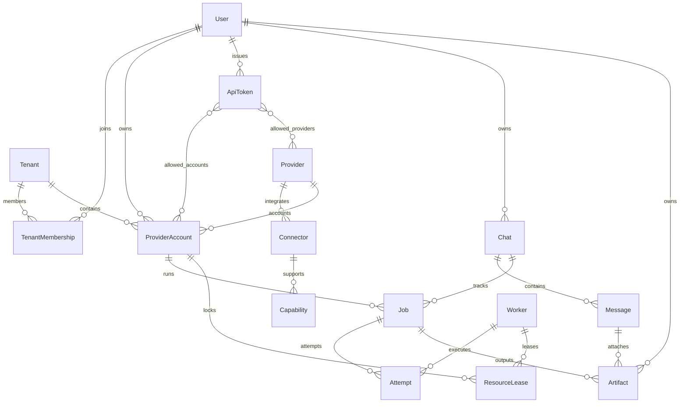

# Stage 06 — PostgreSQL schema and independent tenant data

**Target:** Django 5.2 app-specific migrations; isolated PostgreSQL 16 in GitHub Actions.  
**Production status:** NOT DEPLOYED. The old Flask `/aigetway/`, Codex, DeepSeek Harness, and Antigravity are untouched.  
**Public domain/base path:** still undecided.

## Entity diagram



## Table and constraint overview

| Django app | Tables | Important constraints |
|---|---|---|
| `users` | User (UUID), Tenant, TenantMembership | unique tenant membership; active role; custom Django user declared before first production migration |
| `providers` | Provider, Connector, Capability | unique provider slug, provider+connector slug, connector+direction+modality |
| `accounts` | ProviderAccount | owner+provider+label unique, browser profile UUID unique; credential_ref is only an opaque vault lookup ID |
| `tokens` | ApiToken, Provider/Account allowlists | token digest and display prefix unique; never store plaintext token; expired/revoked checked |
| `chats` | Chat, Message | messages have unique (chat, sequence); chats owned by tenant/user |
| `jobs` | Job, Attempt, Worker, ResourceLease | owner+idempotency key unique when supplied; unique attempt index; one active lease per account |
| `artifacts` | Artifact | input attachment or output record, private opaque storage key and SHA256; no public static URL |

## Migration order and seed

Django-generated initial migrations are committed as source files (some split across `0001_initial`/`0002_initial`/`0003_initial` to resolve cross-app dependencies).

A separate `providers.0002_seed_providers` migration inserts **disabled** metadata rows for ChatGPT, Gemini, DeepSeek, Qwen and Z.ai. This does not connect, authenticate, activate, or enable scraping for those providers. Its reverse operation is a no-op so user-modified provider records are never silently deleted.

## Token security

`ApiToken.objects.issue()` returns (model metadata, raw token) **once**. The token digest uses SHA256 of a cryptographically generated, high-entropy random string. Authentication verifies expiry and revocation; `allows_account` fails closed for accounts not belonging to the exact user and tenant. Database rows do not contain original bearer strings.

Stage 16 will create HTTP token endpoints, object-level authorization, rotation, rate limits and auditable account restrictions. Do not expose the model manager over an unauthenticated API.

## Tenant separation boundaries

Owner/tenant relationships are checked by `clean()` and on ordinary `save()` for ProviderAccount, Chat, Job and Artifact; scoped querysets expose `for_owner(user)`. Database constraints protect uniqueness and most FK relationships.

**Limitation:** These are not PostgreSQL row-level security policies. Direct SQL, `bulk_create()`, `QuerySet.update()` and privileged administrator operations may bypass Python validation. Stages 07–08/16 must implement and test object-level auth and service-layer checks; PostgreSQL RLS can be assessed separately before untrusted multi-tenant production use. This Stage must NOT be called production-safe tenancy.

## CPU/RAM/DB safety

No new PostgreSQL instance or database is created on the VPS by this Stage. CI starts a disposable PostgreSQL 16 container with a test-only password, runs `migrate`, checks `makemigrations --check --dry-run`, rolls back and reapplies the seed migration, and runs Django tests. SQLite tests cover quick model invariants, while Postgres tests verify target engine behavior.

## Reproducing locally in a disposable database (NOT production)

```bash
cd backend
python3 -m venv .venv
source .venv/bin/activate
pip install -r requirements-dev.txt
export DJANGO_SETTINGS_MODULE=config.settings.testing
python manage.py makemigrations --check --dry-run
python manage.py migrate --noinput
python manage.py test apps.core --noinput
```

PostgreSQL CI additionally uses explicit `DATABASE_URL` and `DJANGO_SETTINGS_MODULE=config.settings.staging` with disposable credentials. Never point these commands at the shared `aigetway` production database.

## Definition of Done

All seven app migrations and provider seed are committed, no uncommitted model differences remain, migration/seed replay works on PostgreSQL, schema isolation tests pass, and staging/release promotion remains gated by Stage 01 resource review. Any migration failure is a blocker; never skip a broken migration in production.
